<h1 align="center">OlympiaFlow</h1>

<p align="center">
  <b>120 years of Olympic history, shaped into a star schema with Informatica PowerCenter.</b><br/>
  271,116 rows in. 271,116 rows out. Every layer reconciled, audited and recoverable.
</p>

<p align="center">
  
  
  
  
</p>

<p align="center">
  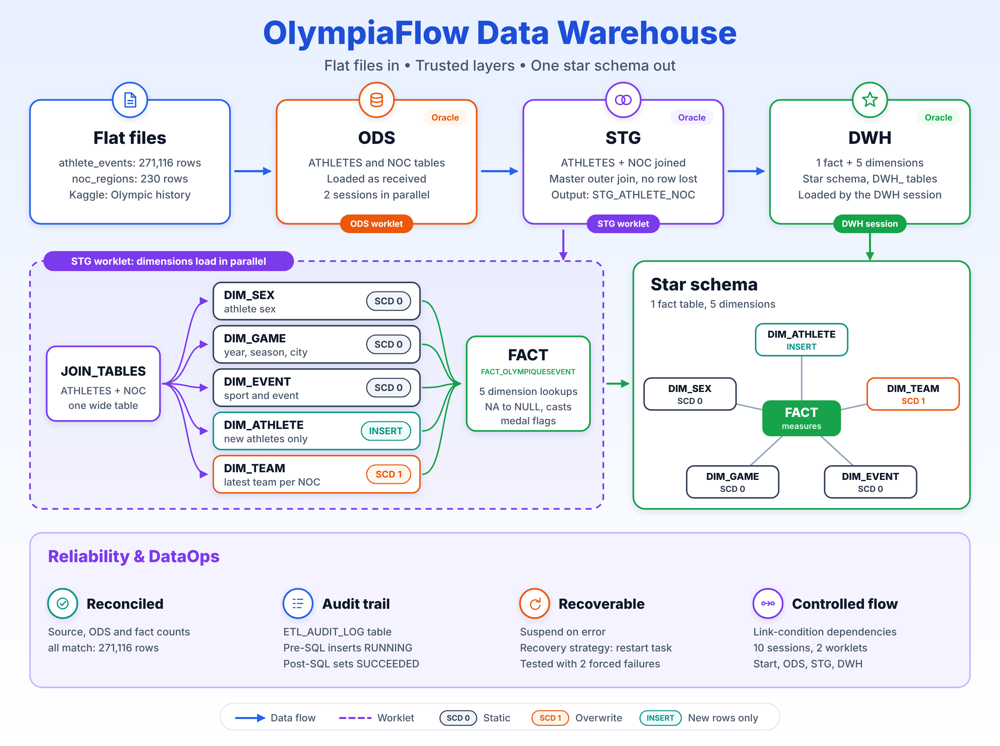
</p>

| 271,116 | 5 + 1 | 10 | 2 | 2 |
|:---:|:---:|:---:|:---:|:---:|
| source rows | dimensions + fact | mappings and sessions | worklets in 1 workflow | recovery scenarios tested |

---

## The story in 30 seconds

Medals are easy to count. Trusting the numbers behind them takes engineering.

The Kaggle dataset *120 years of Olympic history* looks tidy until it meets an ETL tool: missing values arrive as the literal text `NA`, one country can carry a different team name in different years, and the athlete file and the country file only agree if you join them carefully.

OlympiaFlow takes both flat files through three Oracle layers (**ODS, STG, DWH**) and publishes a star schema for analysis. It is built the way a production load would be: parallel worklets, explicit dependencies, an audit trail for every session, and a recovery plan that was tested by breaking the pipeline on purpose.

## How the data flows

```
Flat files  ->  ODS (Oracle)  ->  STG (Oracle)  ->  DWH (Oracle star schema)
 2 CSVs         as received       joined, then       1 fact + 5 dimensions
                                  dimensions + fact
```

| Layer | What happens | Built as |
|---|---|---|
| **Flat files** | `athlete_events` (271,116 rows) and `noc_regions` (230 rows) | CSV sources |
| **ODS** | Both files loaded as received into `ATHLETES` and `NOC` | `ODS` worklet, 2 sessions in parallel |
| **STG** | `ATHLETES` and `NOC` joined into one wide table, `STG_ATHLETE_NOC`. Five dimensions load in parallel, then the fact table | `STG` worklet |
| **DWH** | The star schema is published as `DWH_DIM_*` and `DWH_FACT_OLYMPIQUESEVENT` | `DWH` session |

Source columns: `ID, Name, Sex, Age, Height, Weight, Team, NOC, Games, Year, Season, City, Sport, Event, Medal`.

## Shaping the star

**Grain:** one row per athlete entry in an event, so the fact table holds exactly as many rows as the source: 271,116.

**Measures:** `AGE`, `HEIGHT`, `WEIGHT`, plus three medal flags, `IS_GOLD`, `IS_SILVER`, `IS_BRONZE`.

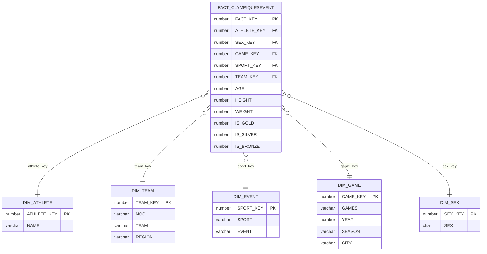

### Why each dimension behaves the way it does

| Dimension | Change handling | Load pattern | Reasoning |
|---|---|---|---|
| `DIM_SEX`, `DIM_GAME`, `DIM_EVENT` | **SCD Type 0** (static) | Source Qualifier, Sorter (distinct), Sequence Generator | These attributes never change for a given natural key, so there is nothing to track or overwrite. |
| `DIM_ATHLETE` | **Insert new only** | Sorter (distinct), self-Lookup, Filter (new rows), Sequence Generator | The lookup stops an athlete from being inserted twice, so a rerun is safe. |
| `DIM_TEAM` | **SCD Type 1** (overwrite) | Sorter (NOC, year descending), Aggregator (first), self-Lookup, Expression, Update Strategy | The same NOC can appear under different team labels across years. The latest label wins and history is not kept. |

`DIM_EVENT` is called `DIM_SPORT` in the design notes, and `DIM_GAME` is stored in Oracle as `DIM_OLYMPIQUES`.

**Fact load:** Source Qualifier, five Lookups (one per dimension), then an Expression that turns `NA` into `NULL`, casts the numeric columns and derives the medal flags.

## Trust, but reconcile

Loaded row counts were compared against the raw source. That check surfaced two silent data-loss problems, both fixed:

| Problem | What happened | Fix |
|---|---|---|
| **Rows rejected at ODS** | The first load returned 206,165 rows instead of 271,116. `Age`, `Height` and `Weight` were typed as numbers, but the source uses the text `NA` for missing values (64,951 rows have it in at least one column). Informatica rejected the **whole row**, not just the field. | The Source Qualifier reads these columns as text. The fact Expression converts `NA` to `NULL` and casts the numbers. |
| **Rows dropped at STG** | Country codes did not match between the two files (`SGP` versus `SIN`), so 349 athlete rows fell out of the join. | A **master outer join** with `NOC` as master and `ATHLETES` as detail, so no athlete row is lost. |

Final check, run in Oracle: the raw copy, the ODS table and the fact table all hold **271,116** rows.

<p align="center">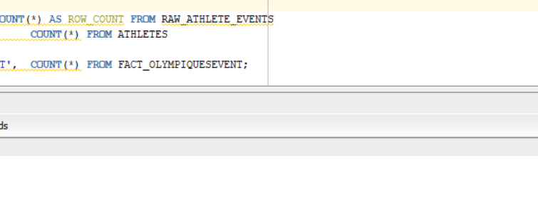</p>

## Built to be audited and recovered

**Audit trail.** Every session target writes to `ETL_AUDIT_LOG`. Pre-SQL inserts a `RUNNING` row when the load starts, and Post-SQL updates it to `SUCCEEDED`. One query tells you whether a run finished, with no need to open Workflow Monitor or the session logs.

<p align="center">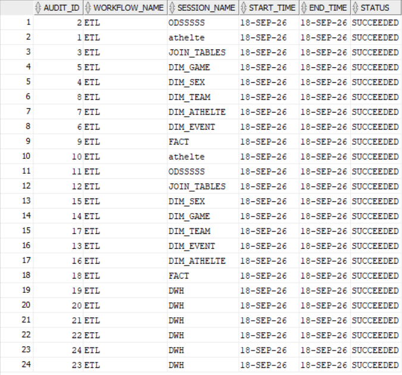</p>

**Recovery plan.** Every session is set to **suspend on error** with the recovery strategy **restart task**. If a task fails, the run pauses instead of pushing incomplete data downstream. In Workflow Monitor, right-click the suspended instance and choose **Recover**: execution resumes from the point of failure, and tasks that already finished are not run again.

The plan was tested twice by breaking the pipeline on purpose:

1. **Aborted a dimension session.** The workflow suspended, then completed after **Recover**.
2. **Deleted a target table.** The workflow suspended, the table was recreated, and **Recover** finished the run.

<details>
<summary><b>See the recovery tests</b></summary>
<br/>
<p align="center">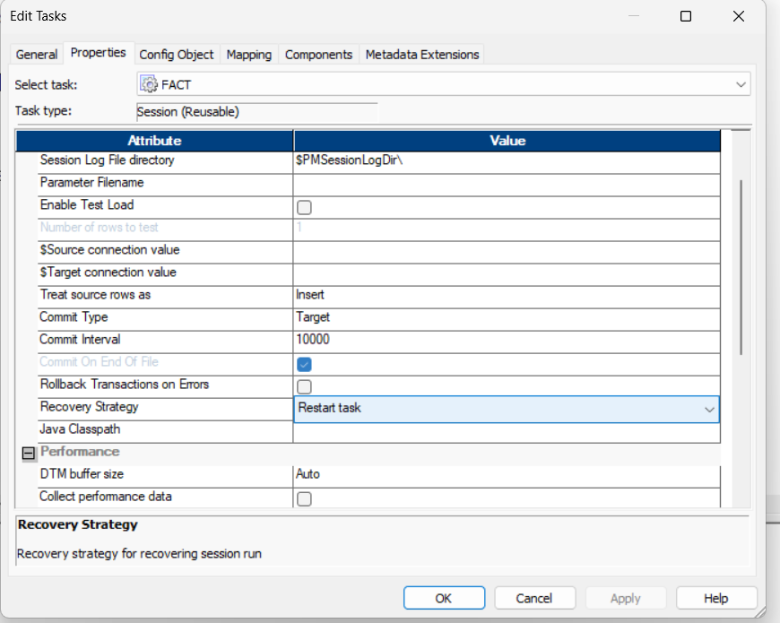</p>
<p align="center">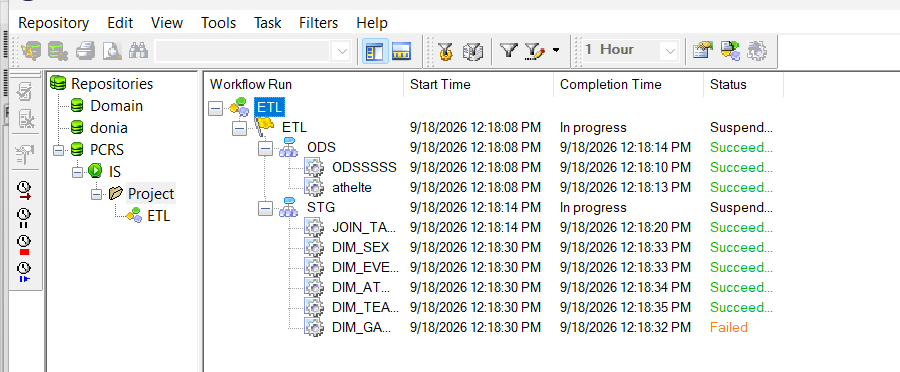</p>
<p align="center">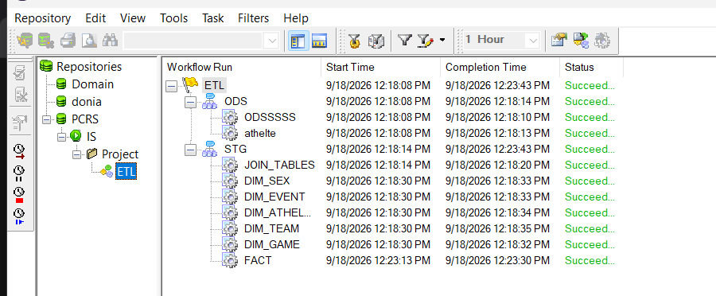</p>
</details>

## Workflow and worklets

The `ETL` workflow runs **Start, ODS, STG, DWH** with explicit link-condition dependencies. The `ODS` worklet loads both source tables in parallel. The `STG` worklet joins the tables, loads the five dimensions in parallel, and builds the fact table only after all of them are done.

<p align="center">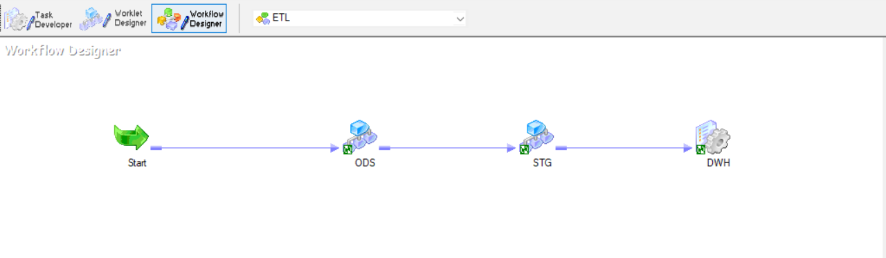</p>
<p align="center">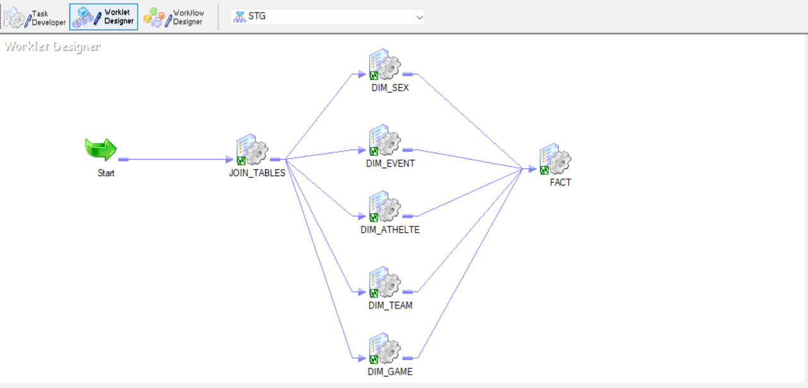</p>

<details>
<summary><b>ODS worklet, successful run and mapping patterns</b></summary>
<br/>
<p align="center">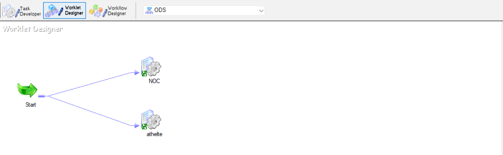</p>
<p align="center">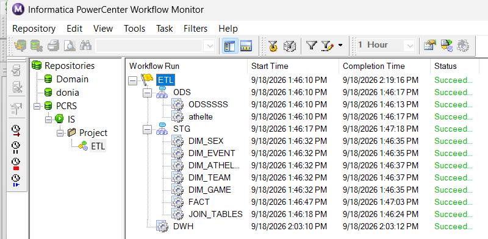</p>
<p align="center">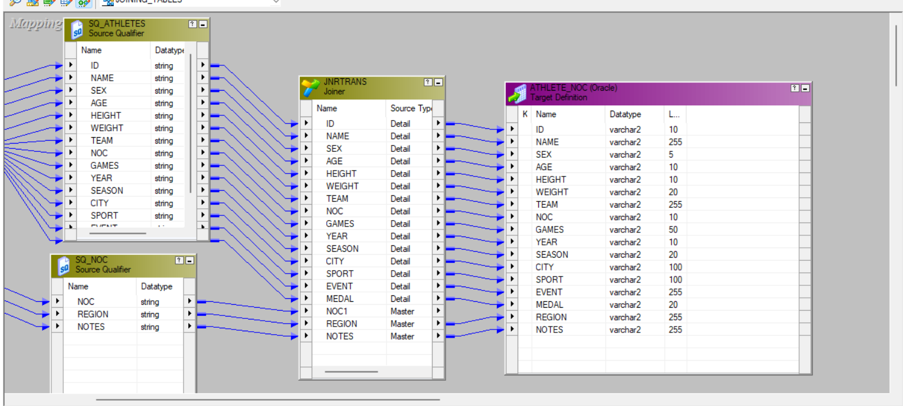</p>
<p align="center">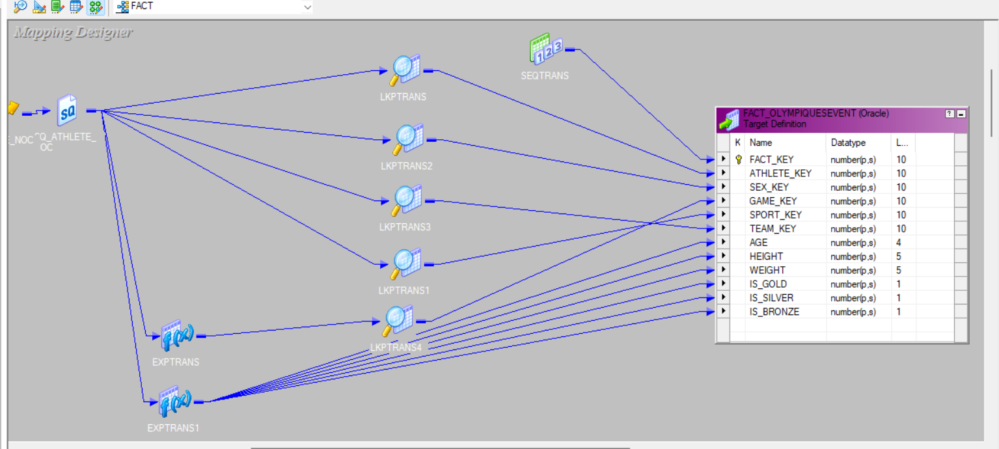</p>
<p align="center">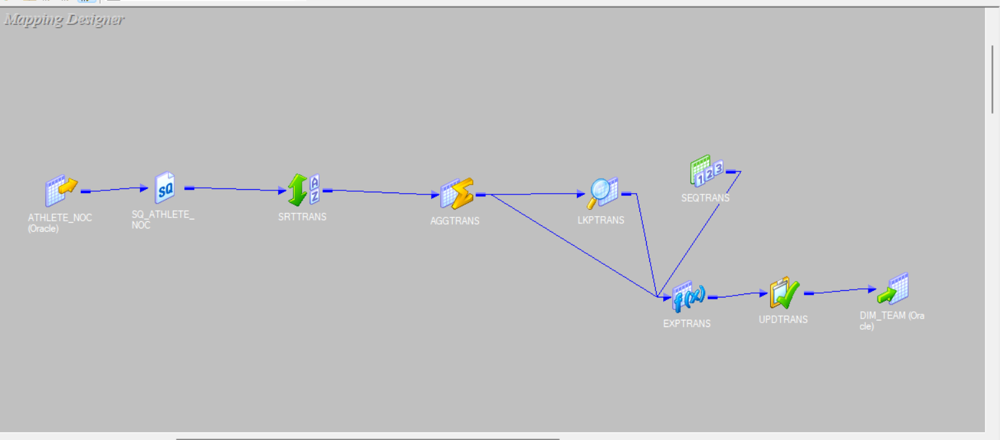</p>
</details>

## Tech stack

| Area | Tools |
|---|---|
| ETL | Informatica PowerCenter (Repository Manager, Designer, Workflow Manager, Workflow Monitor) |
| Database | Oracle, queried with SQL Developer |
| Modeling | Star schema, SCD Type 0 and Type 1, surrogate keys |
| Reliability | Audit table (Pre-SQL / Post-SQL), suspend on error, restart-task recovery |

## Repository contents

```
olympiaflow/
├── assets/
│   └── olympiaflow-architecture.png   architecture diagram
├── docs/
│   └── screenshots/                   workflow, worklets, mappings, audit and recovery evidence
└── README.md
```

## Data source

Kaggle: *120 years of Olympic history: athletes and results* (`athlete_events` and `noc_regions`).

## Author

**Donia Mostafa**, Cairo, Egypt. Data Engineer focused on ETL, data warehousing and DataOps.
[LinkedIn](https://www.linkedin.com/in/donia-mostafa1) | [GitHub](https://github.com/donia444)
